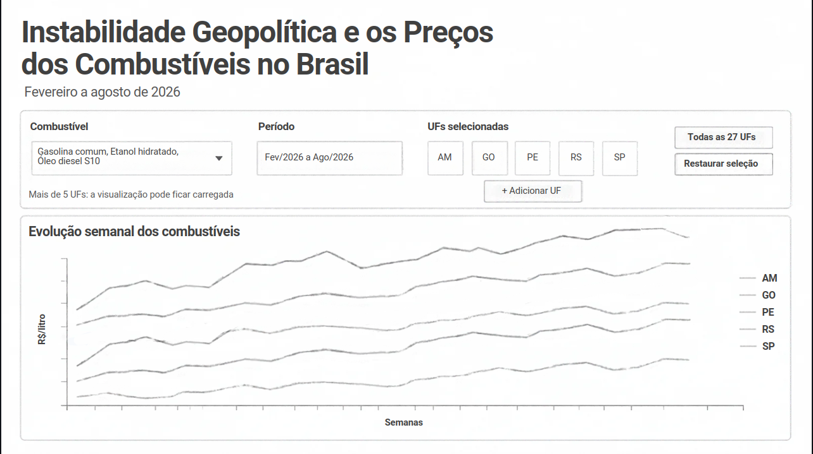
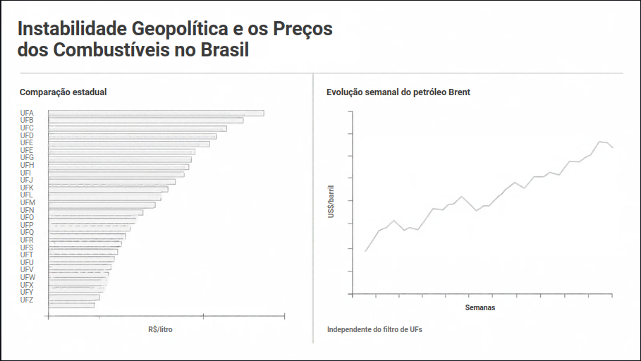
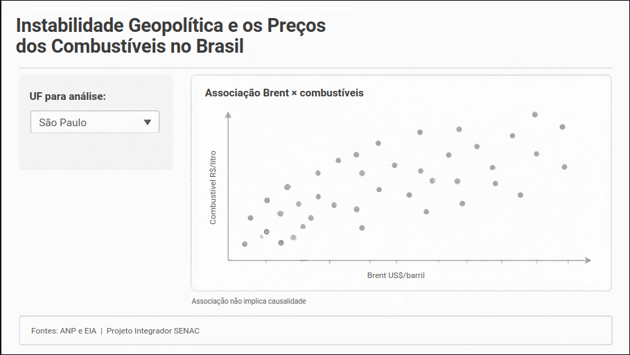

# Instabilidade Geopolítica e os Preços dos Combustíveis no Brasil


## 🌐 Dashboard online

Acesse a aplicação interativa publicada no Streamlit Community Cloud:

**[Acessar dashboard](https://pi-combustiveis-2026.streamlit.app/)**

## 📌 Sobre o projeto

Projeto Integrador desenvolvido no curso de **Análise e Desenvolvimento de Sistemas do Centro Universitário Senac**, com foco na aplicação de ferramentas de ciência de dados e desenvolvimento low-code.

O projeto tem como objetivo analisar o comportamento dos preços dos combustíveis no Brasil, entre janeiro e setembro de 2026, considerando o contexto de instabilidade geopolítica internacional e as oscilações do preço do petróleo Brent.

A solução consiste em um dashboard interativo que permite explorar dados nacionais, regionais e estaduais, identificar padrões de comportamento dos preços e investigar possíveis associações estatísticas entre o mercado internacional de petróleo e os preços de revenda dos combustíveis no Brasil.

## 🎯 Objetivos da análise

- Acompanhar a evolução temporal dos preços dos combustíveis no Brasil.
- Identificar diferenças de comportamento entre regiões e unidades federativas.
- Comparar os preços médios e as variações acumuladas dos combustíveis.
- Investigar possíveis associações entre as oscilações do Brent e os preços nacionais e estaduais.
- Quantificar essas associações por meio de correlação de Pearson e regressão linear simples.
- Contextualizar as oscilações observadas diante dos acontecimentos geopolíticos selecionados para a investigação.

## ✨ Funcionalidades

### Filtros interativos

- Seleção do período de análise.
- Seleção dos combustíveis.
- Seleção individual das 27 unidades federativas.
- Seleção simultânea de todas as UFs.
- Restauração da seleção padrão: AM, GO, PE, RS e SP.
- Ativação e desativação dos marcos geopolíticos.

### Indicadores e visualizações

| Visualização | Descrição |
|---|---|
| Indicadores nacionais | Preço médio mais recente e variação acumulada por combustível. |
| Evolução nacional | Comportamento semanal dos preços dos combustíveis no Brasil. |
| Comparação regional | Evolução dos preços nas cinco regiões brasileiras, com referência nacional. |
| Ranking estadual | Comparação dos preços médios e das variações entre as UFs. |
| Evolução do Brent | Cotação internacional, variação acumulada e média móvel de quatro semanas. |
| Dispersão e regressão | Associação entre o preço do Brent e os preços dos combustíveis. |

### Análises estatísticas

- Coeficiente angular e intercepto da regressão linear.
- Coeficiente de determinação (R²).
- Coeficiente de correlação de Pearson (r).
- p-valor.
- Número de observações pareadas.
- Visualização tabular dos resultados das regressões.
- Consulta aos dados utilizados no pareamento ANP × EIA.

### Experiência do usuário

- Interface responsiva.
- Suporte aos temas claro e escuro.
- Legendas adaptáveis a diferentes tamanhos de tela.
- Tooltips interativos.
- Consulta à metodologia e às fontes de dados.
- Exportação dos dados filtrados e pareados em formato CSV.

## 📊 Fontes de dados

O projeto utiliza dados públicos provenientes de duas fontes oficiais:

| Fonte | Dados utilizados | Periodicidade | Unidade |
|---|---|---|---|
| [ANP](https://www.gov.br/anp/pt-br) | Preços médios de revenda dos combustíveis | Semanal | R$/litro |
| [EIA](https://www.eia.gov/dnav/pet/hist/RBRTEw.htm) | Europe Brent Spot Price FOB | Semanal | US$/barril |

### Escopo da análise

- **Período:** janeiro a setembro de 2026.
- **Abrangência:** Brasil, cinco regiões e 27 unidades federativas.
- **Combustíveis:** gasolina comum, etanol hidratado e óleo diesel S10.
- **Petróleo:** Brent.

### Bases tratadas

Os arquivos utilizados pela aplicação estão disponíveis em `data/processed/`:

- `Base_Semanal_Brasil_2026_Tratada.csv`
- `Base_Semanal_Estados_2026_Tratada.csv`
- `Base_Brent_Weekly_2026_Tratada.csv`

Os arquivos originais são preservados no diretório `data/raw/`, permitindo a reprodução das verificações de integridade e correspondência dos dados.

## 🧠 Metodologia

### Preparação dos dados

As bases são carregadas, validadas e padronizadas antes de serem utilizadas nas visualizações.

O processo contempla:

- Padronização dos nomes dos combustíveis, estados e regiões.
- Conversão e validação de datas.
- Conversão de valores numéricos.
- Identificação de registros inválidos e duplicados.
- Padronização das referências temporais semanais.
- Filtragem conforme as seleções realizadas na interface.

### Agregação dos preços

Os preços nacionais são obtidos diretamente da base nacional da ANP.

Os preços regionais são calculados por meio da média aritmética simples dos preços estaduais disponíveis em cada semana, sem ponderação pelo volume comercializado ou pela população.

As comparações estaduais utilizam os preços médios das semanas disponíveis no período selecionado e suas respectivas variações acumuladas.

### Pareamento temporal ANP × EIA

O pareamento associa a referência semanal do petróleo Brent, registrada na sexta-feira, ao domingo inicial da semana correspondente da ANP.

As semanas são classificadas pela data inicial da ANP. Dessa forma, a semana iniciada em 27/09/2026 utiliza a cotação do Brent referente a 02/10/2026.

O pareamento utiliza os registros efetivamente disponíveis nas bases, sem interpolação de valores ausentes.

### Análise estatística

A investigação da associação entre os preços dos combustíveis e o petróleo Brent utiliza regressão linear simples e correlação de Pearson.

O modelo considera:

- Variável independente (X): preço do petróleo Brent, em US$/barril.
- Variável dependente (Y): preço do combustível, em R$/litro.

Os resultados permitem avaliar a direção e a intensidade da associação linear observada, bem como estimar a variação do preço do combustível associada à variação de uma unidade no preço do Brent.

## 🛠️ Tecnologias utilizadas

| Tecnologia | Finalidade |
|---|---|
| Python 3.14 | Linguagem de programação. |
| Streamlit | Desenvolvimento e execução da aplicação web interativa. |
| Pandas | Manipulação, tratamento e agregação dos dados. |
| NumPy | Operações numéricas e cálculos matemáticos. |
| SciPy | Cálculos e análises estatísticas. |
| Altair | Construção de visualizações declarativas e interativas. |
| Plotly | Construção de visualizações interativas, incluindo gráficos de dispersão. |
| CSS | Personalização visual e responsividade. |
| Git | Controle de versão. |
| GitHub | Hospedagem do código e gerenciamento das atividades. |
| Streamlit Community Cloud | Publicação da aplicação web. |
| Canva | Prototipação visual da interface. |

## 🏗️ Arquitetura do projeto

O projeto utiliza uma arquitetura modular, com separação entre interface, carregamento de dados, cálculos estatísticos, configurações e visualizações.

### Estrutura principal

```text
projeto_integrador/
│
├── .streamlit/
│   └── config.toml
│
├── assets/
│   └── css/
│       └── styles.css
│
├── data/
│   ├── raw/
│   └── processed/
│
├── docs/
│   └── validacao/
│
├── scripts/
│   ├── auditar_bases.py
│   ├── comparar_raw_processed.py
│   └── comparar_eia.py
│
├── app.py
├── analises.py
├── carregamento.py
├── config.py
├── graficos.py
├── requirements.txt
├── .gitignore
├── LICENSE
└── README.md
```

### Responsabilidades dos módulos

| Arquivo | Responsabilidade |
|---|---|
| `app.py` | Interface, gerenciamento dos filtros e orquestração da aplicação. |
| `analises.py` | Cálculos, agregações, indicadores, pareamentos e análises estatísticas. |
| `carregamento.py` | Carregamento, validação, padronização e filtragem das bases. |
| `config.py` | Configurações, constantes, caminhos, nomenclaturas, cores e marcos geopolíticos. |
| `graficos.py` | Construção e configuração das visualizações. |
| `assets/css/styles.css` | Estilização personalizada da interface. |
| `.streamlit/config.toml` | Configuração visual nativa do Streamlit. |
| `requirements.txt` | Dependências necessárias para execução da aplicação. |

O ambiente virtual (`venv/`) é criado localmente e não deve ser versionado.

## 🎨 Prototipação da interface

Antes da implementação, foram desenvolvidos wireframes utilizando o Canva para definir a organização das informações, a disposição dos filtros, os indicadores e as visualizações do dashboard.

Os protótipos serviram como referência para o desenvolvimento da aplicação e foram aprimorados ao longo do projeto.

<details>
<summary>Visualizar os wireframes originais</summary>

### Filtros e evolução dos combustíveis



### Comparação estadual e evolução do Brent



### Associação entre Brent e combustíveis



</details>

## 🧪 Validação dos dados

As bases foram submetidas a verificações automatizadas de integridade estrutural, continuidade temporal nacional, correspondência com os arquivos originais e pareamento entre ANP e EIA.

### Resultados da validação

| Indicador | Resultado |
|---|---:|
| Registros ANP Brasil | 117 |
| Registros ANP Estados | 3.134 |
| Registros EIA Brent | 45 |
| Total de registros comparados | 3.296 |
| Divergências finais nos valores comparados | 0 |
| Unidades federativas | 27 |
| Regiões brasileiras | 5 |
| Semanas nacionais por combustível | 39 |
| Observações nacionais pareadas ANP × EIA | 117 |
| Verificações automatizadas | 25 |
| Falhas na auditoria | 0 |

A auditoria automatizada foi executada novamente após a refatoração dos módulos, mantendo o resultado de 25 verificações sem falhas.

### Reproduzir a auditoria

Na raiz do projeto, com o ambiente virtual ativado:

```bash
python -m scripts.auditar_bases
```

Os procedimentos complementares e os resultados detalhados encontram-se na [documentação de validação](docs/validacao/README.md).

## 🚀 Como executar o projeto

### 1. Clonar o repositório

```bash
git clone https://github.com/alauracarlotta/Projeto-Integrador-Desenvolvimento-Low-Code-em-Ciencia-de-Dados.git

cd Projeto-Integrador-Desenvolvimento-Low-Code-em-Ciencia-de-Dados
```

### 2. Criar o ambiente virtual

O projeto foi desenvolvido utilizando Python 3.14.

```bash
python3.14 -m venv venv
```

### 3. Ativar o ambiente virtual

**Linux/macOS:**

```bash
source venv/bin/activate
```

**Windows (PowerShell):**

```powershell
.\venv\Scripts\Activate.ps1
```

No Windows, caso necessário, utilize `py -3.14 -m venv venv` para criar o ambiente virtual.

### 4. Instalar as dependências

```bash
python -m pip install -r requirements.txt
```

### 5. Executar a aplicação

```bash
python -m streamlit run app.py
```

A aplicação estará disponível no navegador, geralmente pelo endereço:

`http://localhost:8501`

### Configuração alternativa das bases

Por padrão, o projeto utiliza as bases disponíveis em `data/processed/`.

Caso seja necessário utilizar outra localização, é possível definir a variável de ambiente `PI_BASES_DIR` com o caminho do diretório que contém os três arquivos CSV tratados.

**Linux/macOS:**

```bash
export PI_BASES_DIR="/caminho/para/as/bases"
```

**Windows (PowerShell):**

```powershell
$env:PI_BASES_DIR = "C:\caminho\para\as\bases"
```

## ☁️ Publicação

A aplicação está publicada no Streamlit Community Cloud, integrado ao repositório GitHub.

O dashboard pode ser acessado diretamente pelo navegador, sem necessidade de instalação local das dependências.

**[Acessar aplicação publicada](https://pi-combustiveis-2026.streamlit.app/)**

## ⚠️ Limitações da análise

- A associação estatística entre duas variáveis não implica causalidade.
- O modelo de regressão linear simples não contempla simultaneamente outros fatores econômicos que podem influenciar os preços dos combustíveis.
- As cotações do Brent são expressas em dólares, enquanto os preços dos combustíveis são expressos em reais, sem aplicação de conversão cambial no modelo.
- Fatores como câmbio, tributação, políticas de precificação, oferta, demanda e custos logísticos podem influenciar os resultados.
- Não são modeladas possíveis defasagens temporais entre as oscilações internacionais e os preços nacionais.
- A autocorrelação e as tendências temporais podem influenciar as estimativas estatísticas e a interpretação dos p-valores.
- As médias regionais não são ponderadas.
- Os marcos geopolíticos são referências contextuais selecionadas para a investigação e requerem fundamentação documental.
- Os resultados estão restritos ao período e às bases analisadas.

A interpretação dos resultados deve considerar essas limitações, evitando atribuir exclusivamente ao contexto geopolítico ou às oscilações do Brent as variações observadas nos preços dos combustíveis.

## 📋 Gestão do projeto

O desenvolvimento foi organizado por meio do GitHub Projects, utilizando um quadro Kanban, issues, responsáveis e prioridades.

As atividades foram distribuídas em quatro milestones:

| Milestone | Objetivo |
|---|---|
| M1 | Base de dados |
| M2 | Protótipo |
| M3 | Dashboard funcional |
| M4 | Documento de conclusões |

A organização das atividades permitiu acompanhar o desenvolvimento, registrar decisões técnicas, documentar validações e distribuir as responsabilidades entre as integrantes do projeto.

## 📚 Documentação complementar

- [Procedimentos de validação das bases](docs/validacao/README.md)
- [Relatório de auditoria dos dados tratados](docs/validacao/auditoria-dados.md)
- [Resultados da auditoria automatizada](docs/validacao/resultado_auditoria.csv)
- [Auditoria da base EIA](docs/validacao/auditoria_eia.csv)
- [Pareamento nacional ANP × EIA](docs/validacao/pareamento_anp_eia.csv)

## 👩‍💻 Autoras

Projeto desenvolvido por:

- **[Laura Carlota](https://github.com/alauracarlotta)**
- **[Flávia](https://github.com/CalegariF)**

**Instituição:** Centro Universitário Senac  
**Curso:** Análise e Desenvolvimento de Sistemas  
**Projeto Integrador:** Desenvolvimento Low-Code em Ciência de Dados  
**Ano:** 2026

## 📜 Licença

O código-fonte deste projeto está disponibilizado sob a licença MIT.

Consulte o arquivo [LICENSE](LICENSE) para mais informações.

Os dados públicos utilizados permanecem sujeitos às condições de utilização estabelecidas pelas respectivas fontes oficiais.

---

Projeto desenvolvido para fins acadêmicos, com aplicação prática de ciência de dados, análise exploratória, visualização de informações e desenvolvimento de software.
